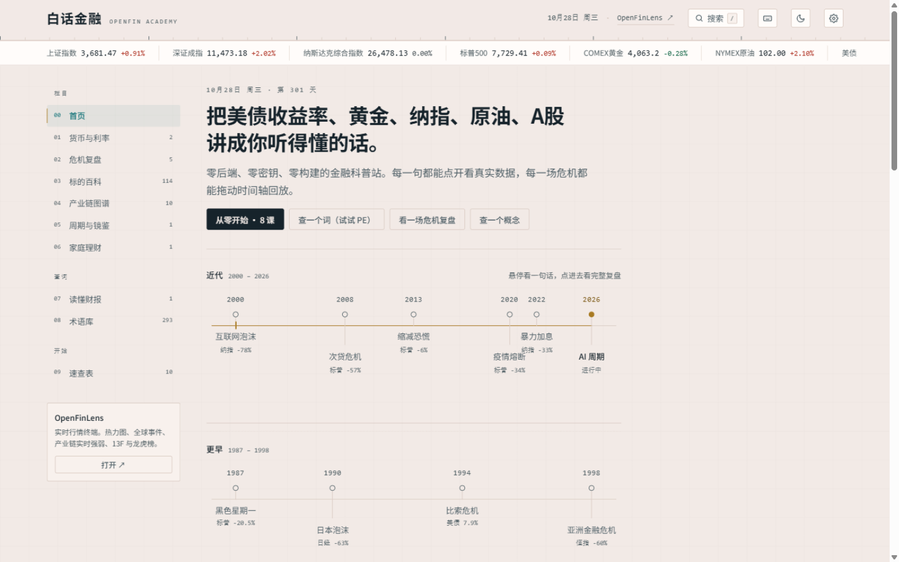
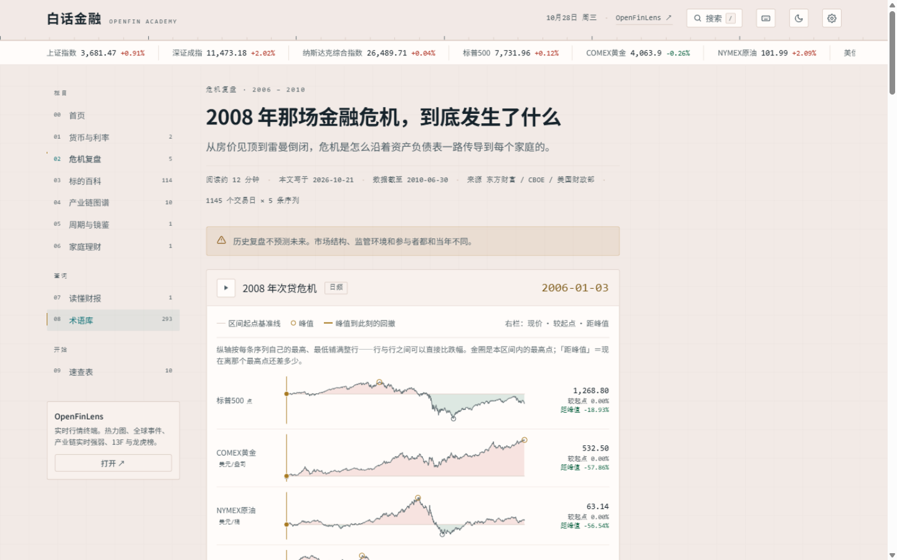

<div align="center">

# 白话金融 · OpenFin Academy

**把美债收益率、黄金、纳指、原油、A股和 AI 产业链，讲成金融小白和宝妈听得懂的话。**

没有后端，没有 API key，没有构建。clone 下来用本地服务器打开，它就跑起来了（浏览器不允许 `file://` 读取数据文件，所以不能直接双击 `index.html`）。

**[在线体验 →](https://5777-wq.github.io/openfin-academy/)**

[](LICENSE)

行情终端：[OpenFinLens](https://5777-wq.github.io/openfinlens/) —— A股/港股/美股/加密/全球事件，一块屏幕读完的纯前端行情终端



</div>

---

## 为什么有这个项目

财经内容的问题不是信息太少，是**信息用错了语言**。

一个说"美债收益率上冲，全市场风险偏好收缩"的人，和一个说"美国借钱给别人要收的利息涨了，别的投资就变得不划算了，股票于是跌"的人，讲的是同一件事。区别只在后者能不能让一个没投过资的人听明白。

这个站点想做的事只有一件：**把机制讲清楚，然后把数据摆在旁边让人自己看。**

- 每个数字都能点开看来源，没有"据说""业内普遍认为"
- 每场危机都能拖动时间轴回放，看到那一天各资产到底怎么了
- 每篇文末都写清数据截止日期
- **不荐股、不荐仓、不预测点位**——只解释机制、复盘历史、呈现真实数据

## 三个签名交互

### 时代横轴

首页的主导航不是一排栏目按钮，而是一条横跨 1990 到 2026 的时间轴。每个节点是一场已经发生过的危机或周期，悬停看一句话，点进去看完整复盘。

这个站点的本质是「时间 × 资产 × 事件」，所以时间轴就该是它的门面。

### 危机回放器

多资产同步时间轴，**日频**。标普500、黄金、原油、美债10年、VIX 画在同一条轴上，拖动滑块就能看到任意一天各资产的反应，事件标注可点开。

日频不是炫技：月频会把崩盘日藏起来——1997 年 10 月恒指月末收 16459，但当月最低收盘只有 9059。**日频才能拖到那一天。**

2008 年那场最反直觉的一幕——9 月 15 日雷曼倒闭当天，标普跌 4.71% 而黄金**涨**到 787 美元——就是在这里被看到的。

**纵向必须看得出跌幅。** 每条轨道按它自己的最高、最低铺满整行，所以行与行之间可以直接比"跌了多少"。基准线是区间起点：线上方填涨色、下方填跌色（红涨绿跌），面积大小就是涨跌本身。峰值画金圈，从峰值到游标拉一条金色回撤段——那根斜线就是回撤。右栏三行：现价 / 较起点 / 距峰值；收益率一律用「个百分点」，价格用「%」，不混着写。



### 术语抽屉

正文里的关键名词带金色虚线下划线。点一下，右侧滑出解释，**阅读位置不丢**。每条术语固定四段：一句话 / 一个比喻 / 一个真实数字 / 一个坑。

每个词还有一条能直接发出去的链接：`#/term/<id>`（例：`#/term/gold`），落地就是那个四段式术语卡。`#/terms` 是完整术语库。行情终端那边鼠标挨着一个标的就浮出「这是什么」，点一下就跳到对应的术语页——两边共用同一套解释，不各说各话。

术语库现在有 **189 个词**，按十个分类排：研报数据 / 基金与策略 / 资产类别 / 期权与期权策略 / 宏观经济 / 基础概念 / 微观与行为 / 机构与人物 / 风险与交易 / 技术指标。每个分类都配一张**速查表**（`#/data?cat=macro` 这种），一行一个词，看不懂某个数时不用在 180 多条里翻；每张表前面还有「入门三词」，第一次接触这一类先读这三个就够用。

词条卡在「一句话」之后还多一段**名称由来**——「日经225」的 225 是 1950 年定下的样本股数量、成分股换了几轮但数字没变；「标普500」的 500 是 500 家公司；「恒生指数」干脆没有数字，1969 年发布时 33 只成分股，到 2024 年 11 月已经 82 只。名字里的数字不等于现在的覆盖面，这是读指数最常踩的坑。

## 六大栏目

| 栏目 | 内容 |
|---|---|
| **01 货币与利率** | 全站地基。为什么美债收益率是全球无风险利率，通胀怎么毁掉储蓄 |
| **02 危机复盘** | **1987 黑色星期一 / 1990 日本泡沫 / 1994 墨西哥比索危机 / 1998 亚洲金融危机与 LTCM / 2008 次贷**——每场配一个日频回放器 |
| **03 标的百科** | **和行情终端同一份标的清单**（90+ 只：指数 / A股 / 港股 / 美股 / 商品 / 利率），每只都能点开看真实历史读数（峰值、谷底、峰谷跌幅、近一年涨跌）；旗舰标的另有专文 |
| **04 产业链图谱** | 10 条产业链 49 环节 163 只成分股，环节强弱实时算给你看 |
| **05 周期与镜鉴** | 本轮 AI 周期定位 + 2000 年互联网泡沫六维度对照 |
| **06 家庭理财** | 闲钱四分法、期限匹配、风险承受力测评。写给第一次认真管钱的人 |

## 数据从哪来

**全部免密钥，官方或公开接口。**

| 品类 | 来源 | 说明 |
|---|---|---|
| 指数 / 商品 / 外汇 | 东方财富 `push2his` | 月线长历史，标普回溯到 **1986**、日经225 到 **1987** |
| 实时行情 | 东方财富 `ulist` | 浏览器直连，一次请求拿全报价条 |
| **VIX 恐慌指数** | CBOE 官方 CSV | 1990 年至今日频 |
| **美债收益率曲线** | 美国财政部官方 CSV | 1990 年至今，1M–30Y 全期限日频 |
| 产业链成分股 | 东方财富（secid 解析后落盘） | 177 只，全市场实时 |
| 事件 / 概率 / 持仓 | 复用 OpenFinLens 采集产物 | GitHub Actions 定时抓取 |

**危机回放包是日频的**（`data/history/crisis-*.json`），月频会把崩盘日藏起来——1997 年 10 月恒指月末收 16459，当月最低收盘只有 9059。

海外源（财政部 / CBOE）**不在浏览器里请求**——采集脚本拉下来存成静态 JSON 提交进仓库，所以国内访问也不受影响。

产物全部登记在 [`data/series-map.json`](data/series-map.json)，正文只能引用注册表里的 id，杜绝"临时抓一个数就写进文章"。

## 快速开始

```bash
git clone https://github.com/5777-wq/openfin-academy.git
cd openfin-academy
# 用本地服务器打开（零依赖，正确处理 keep-alive）：
node scripts/serve.mjs 8765   # → http://127.0.0.1:8765
#
# 注意：不能直接双击 index.html。浏览器不允许 file:// 页面读取 JSON，
# 那样打开只会得到一个空页面（站里会提示你换成服务器打开）。
```

**没有任何构建步骤，没有 `node_modules`。** 依赖只有三个：

```bash
node _scripts/sync-core.mjs       # 从 OpenFinLens 同步共享代码到 vendor/
node _scripts/build-content.mjs   # content/*.md → data/content/*.json
node _scripts/collect-history.mjs # 拉长历史 → data/history/*.json
node scripts/reconcile.mjs 2008-09-15 SPX GC00Y   # 写文章时查准确值，别凭印象写数字
node _test/run-all.mjs            # 引擎 / 数据契约 / 内容契约
node _test/render-test.mjs        # 无浏览器渲染测试
```

排障时给地址加上 `?debug=1`，页面左下角会显示启动轨迹（卡在哪一步一目了然）。

## 与 OpenFinLens 的关系

| | OpenFinLens | OpenFin Academy |
|---|---|---|
| 形态 | 单页实时终端 | 多栏目内容站 + 交互式科普 |
| 回答 | 现在发生了什么 | 为什么是这样 / 这意味着什么 / 以前发生过什么 |
| 数据 | 实时轮询 + 静态 JSON | 实时 + 长历史 + 静态内容 |

**数据同源，视角互补。** 共享代码通过 `_scripts/sync-core.mjs` **单向**从 OpenFinLens 同步到 `vendor/`（记录上游 commit SHA，CI 校验），两站各自独立发布、互不耦合。

两站互相导流：OpenFinLens 顶栏指向本站，本站每个数据面板下方指向 OpenFinLens 的实时看板。

## 键盘

| 键 | 作用 |
|---|---|
| `/` 或 `⌘K` | 命令面板（搜术语 / 文章 / 标的） |
| `?` | 快捷键面板 |
| `←` `→` | 危机回放器前后步进 |
| `T` | 切换日夜皮肤 |
| `Esc` | 关闭抽屉 / 面板 |

## 目录

```
openfin-academy/
├── index.html              # SPA 壳
├── css/                    # tokens / layout / components 三层
├── js/
│   ├── engine/             # 纯计算层：无 DOM 无网络，node 可测
│   ├── components/         # 签名交互：时代横轴 / 术语抽屉 / 回放器 / 产业链
│   ├── views/              # 各栏目视图
│   ├── sources/            # 数据源适配器（网络调用唯一合法位置）
│   └── site/               # 本站自研
├── vendor/                 # ← 从 OpenFinLens 自动同步，勿手改
├── content/                # Markdown 源（贡献者写这里）
├── data/                   # 产物：内容 JSON / 长历史 / 序列注册表
├── scripts/serve.mjs       # 零依赖本地静态服务器
├── _scripts/               # 同步 / 编译 / 采集
└── _test/                  # node 直跑测试
    ├── run-all.mjs         # 引擎 / 数据契约 / 内容契约
    └── render-test.mjs     # 无浏览器渲染测试（DOM 桩跑真视图）
```

## 写作规范

每篇文章四段式术语卡、六项自检、免责声明位置固定。见 [docs/WRITING-GUIDE.md](docs/WRITING-GUIDE.md)。

架构与数据流：[docs/ARCHITECTURE.md](docs/ARCHITECTURE.md) · 数据源明细：[docs/DATA-SOURCES.md](docs/DATA-SOURCES.md)

## 免责声明

本站只做金融知识科普，**不构成投资建议，不推荐任何具体产品，不预测市场走势**。

数据来自第三方公开接口，有延迟、会出错；历史不代表未来。据此决策，风险自负。

## License

[MIT](LICENSE)
